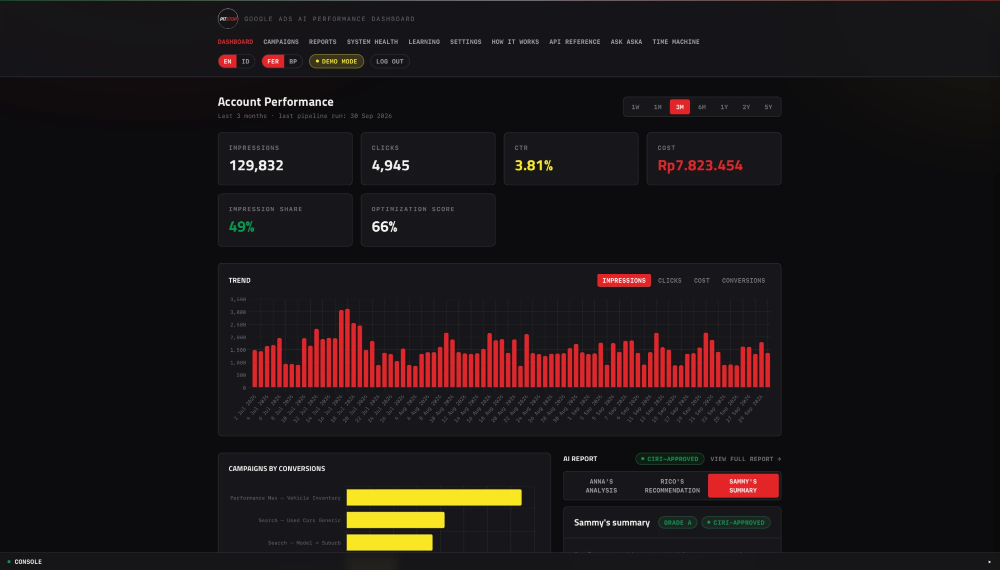

# Pitstop

[](https://github.com/NabilRobert/pitstop-crew-public/actions/workflows/ci.yml)

An AI performance dashboard for Google Ads, and a case study of an agent
system; the data is synthetic. A small team of LLM agents reads an
account's stored performance data, writes the analysis, turns it into
recommendations and summarises the result. A fourth agent, the critic,
reviews every output before anyone sees it.

Google Ads' own Recommendations tab leans towards spending more. Pitstop
gives the owner of a small account an analysis that isn't selling
anything: what changed, why, and what to do about it, with the evidence
attached.



**Live demo:** https://pitcrew-public.my.id, read-only and behind a login.

## The result

It ran unattended on a schedule, making live model calls: 65 of 68
daily-pipeline runs, scheduled or started by hand, succeeded. Measuring it
afterwards showed that its own quality chart **understated failures about
threefold**: it showed 32.5% of August's outputs flagged, when 95.0% of
the final versions were.

The [case study](docs/case-study.md) covers how it ran, what went wrong,
what each fix measurably changed, and what is and isn't real. Every number
comes from a SQL query over the system's own records
([docs/evidence/](docs/evidence/)).

## How it works

```
Google Ads data ──► Postgres ──► Anna (analysis) ──► Rico (recommendations) ──► Sammy (summary)
  (or demo data)                    ▲                    ▲                         ▲
                                    └──── Ciri, the critic: approve / revise / flag ┘
```

- **Code decides approval, not the model.** The critic gives each issue a
  severity, and an output with a high-severity issue doesn't pass.
- **SQL computes the facts.** Rankings and totals reach the agents already
  worked out, because models are worst at arithmetic over tables.
- **Every claim can be traced.** Each report section shows its draft,
  critique and revision, and the Run Inspector records every model call.
- **A keyword optimizer** ranks suggestions with a deterministic engine,
  tested against planted problems with known answers.

## Run it locally

You need Node.js 20+ and a Postgres database. With no Google Ads
credentials it runs in demo mode (`DATA_SOURCE=demo`).

```bash
npm install                                          # backend and frontend (npm workspaces)
cp .env.example .env                                 # database URL, AUTH_USERNAME / AUTH_PASSWORD
cp frontend/.env.local.example frontend/.env.local
cd backend && npx tsx scripts/initDb.ts && cd ..     # create the schema (safe to re-run)
npm run dev:backend                                  # API on :8000
npm run dev:frontend                                 # UI on :5173
```

Running a pipeline makes paid model calls, through any OpenAI-compatible
endpoint: set its URL and key in `.env`. To look at the UI with no backend
and no keys, run `npm run mock-api -w frontend`, which serves test data on
`:8000`.

Tests: `npm run test:backend`, `npm run test:frontend` and
`npm run typecheck -w frontend`.

## Layout

```
backend/        the API, agents, pipeline and keyword optimizer (TypeScript, Express, Postgres)
frontend/       the dashboard (Vue 3, Vite, Tailwind)
db/             the database schema
evidence/       the SQL behind every number in the case study
deploy/demo/    the read-only demo stack, and the check that it can't spend money
docs/           the guide, case study, evidence, user manual and planning docs
```

## Docs

- [docs/guide.md](docs/guide.md): a plain-English guide to the code, with a
  glossary.
- [docs/case-study.md](docs/case-study.md): the full write-up.
- [deploy/demo/README.md](deploy/demo/README.md): the demo stack.
- [docs/manual/](docs/manual/): the user manual, in Indonesian.
- [docs/planning/](docs/planning/): every spec and plan, and
  [JOURNEY.md](JOURNEY.md), the log of the case-study work.
