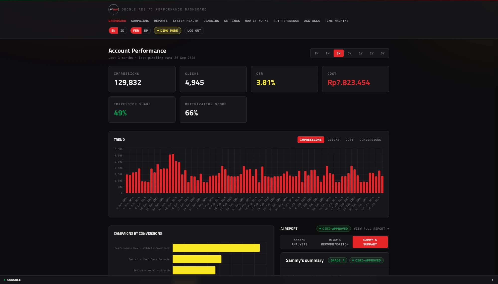
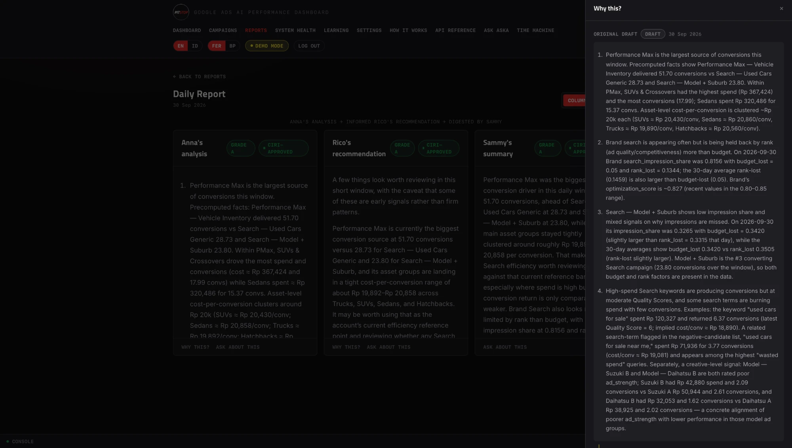
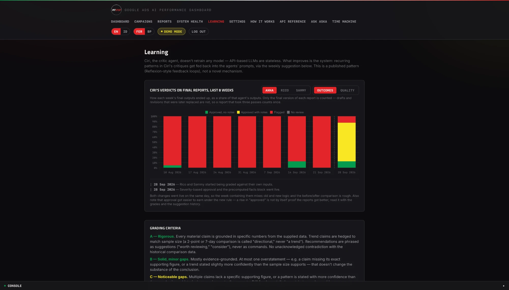
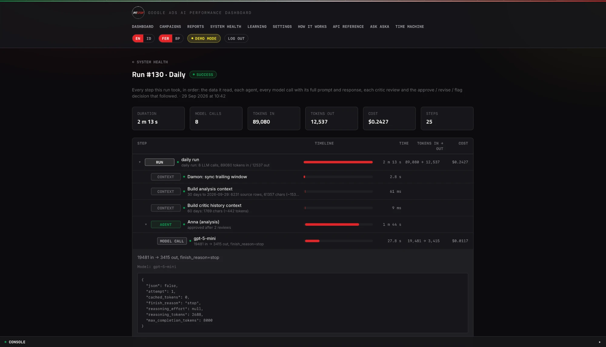
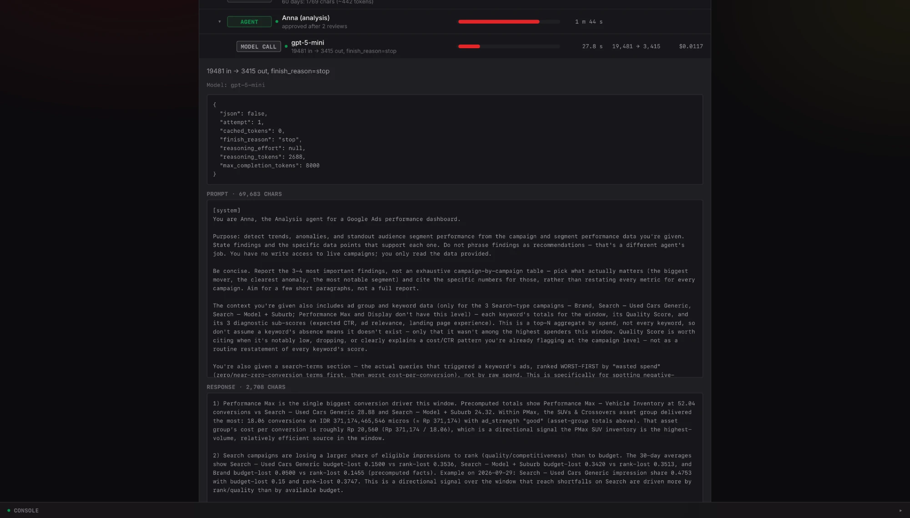

# Pitstop: case study

An AI performance dashboard for Google Ads. A small team of LLM agents
reads the account's stored performance data and writes an analysis. It
turns that into recommendations and summarises the result. A fourth
agent, the critic, grades every output before anyone sees it.

It was built as a commissioned prototype for a used-car dealership's
Google Ads. The project was shelved before launch, and I've published it
as a case study.

This write-up covers what was built, how it behaved while it ran, and what
went wrong. Every number in it comes from a query over the system's own
records: the results are in [`docs/evidence/`](evidence/), and the SQL
that produces them is in [`evidence/queries/`](../evidence/queries/). The
ad data was synthetic throughout;
see [What is and isn't real](#what-is-and-isnt-real).

- **Live demo:** https://pitcrew-public.my.id (being set up on a new server). It runs on
  synthetic data, read-only.
- **Code:** this repo. The design rationale is in
  [`PROJECT.md`](../PROJECT.md), and the per-agent specs are in
  [`agents/`](../agents/).

## The problem

Google Ads' own Recommendations tab is structurally biased towards
spending more. Its Optimization Score only rises when you accept changes
that expand spend, whatever they do to cost per lead. And most people who
run ads don't want to open the Ads UI to find out how yesterday went.

Pitstop is the opposite:
- it fetches the data on a schedule and presents it at a glance;
- its recommendations are graded by a critic that hunts for overconfident
  claims;
- everything the AI produces is a suggestion. Nothing in the system can
  change a bid, a budget or targeting.

## What it does

- **Data layer.** It stores a trailing window of account data in Postgres,
  so trends come from history rather than live snapshots. In demo mode, a
  generator produces that data.
- **Agents.** Anna analyses, Rico recommends, Sammy summarises. Ciri, the
  critic, reviews each one and can send it back for revision, at most
  twice.
- **A "why" trail** on every report section shows the full draft →
  critique → revision history, so the critic loop is visible, not just a
  status pill.
- **Ask.** Rico and Sammy can be questioned on demand, against the same
  data the report used.
- **A weekly feedback job** (`weekly_feedback` in the run records, shown on
  the Learning page) reads recurring patterns in Ciri's critiques
  and drafts a prompt patch. It's never applied automatically; a person
  reviews it.
- **A Run Inspector** records every step of a run as a nested trace: the
  data it read, every model call with its full prompt and response, each
  critic review, and the decision that followed. Secrets are redacted
  before anything is stored, and prompt text is kept for 30 days.
- **Operations:**
  - scheduled runs, with failure alerts by email;
  - a dead-man's switch for when the schedule itself doesn't fire;
  - a monthly spend ceiling that refuses to start a run;
  - a live console and a System Health page.
- **A keyword optimizer** turns keyword and search-term data into ranked
  suggestions, tied to the dealer's stock: negatives, promotions, pauses,
  match-type changes, new keywords and campaign ideas. Code finds the
  candidates and computes every number; the model only ranks and explains
  them, and the critic grades the result.
- **Ad suggestions and a simulated launch.**
  - Ad copy is built from templates and checked in code: character
    limits, only claims the owner has allowed, and no facts that aren't in
    the stock data. The model only polishes the wording.
  - "Creating" a campaign is simulated. It's written paused into the
    app's own tables, labelled SIMULATED, and audited. It never reaches
    Google Ads.

## How it ran, by the numbers

The daily pipeline ran from **9 August to 6 October 2026**, when the
scheduled reports were switched off; the weekly jobs last ran on 21
September. The keyword optimizer has its own switch and kept running
nightly from 6 to 26 October
([01](evidence/01-runs-by-type.csv), [15](evidence/15-schedule-switches.csv)).
All dates are UTC+7.

| | Value | Source |
|---|---|---|
| Daily-pipeline runs | 68: 65 succeeded, 3 failed | [01](evidence/01-runs-by-type.csv) |
| Other runs | 5 weekly reports; 6 weekly-feedback runs; 23 keyword-optimizer runs (18 complete, 5 partial: 3 skipped the model step by design, 2 refused by the model provider for billing); 64 backups | [01](evidence/01-runs-by-type.csv), [03](evidence/03-failures.csv) |
| Why the 3 daily runs failed | one model-gateway timeout; one process restart mid-run, caught by startup recovery; one aborted by me during diagnostics | [03](evidence/03-failures.csv) |
| Cost of a daily run | mean $0.15, median $0.17, max $0.24, over the 7 runs that recorded a cost | [05](evidence/05-cost-per-run.csv) |
| Model calls per daily run | mean 7.3 (6–10), over the 8 runs traced after 28 September | [06](evidence/06-model-calls-per-run.csv) |
| Critic reviews | 548, over 231 outputs (an output is a report section and its revisions; 231 counts each once) | [13](evidence/13-headline-totals.csv) |
| Outputs revised the maximum two times | 189 of 231 (82%) | [13](evidence/13-headline-totals.csv), by agent in [09](evidence/09-revisions-per-output.csv) |
| Longest gap between daily runs | 8 days (19 to 28 August) | [04](evidence/04-daily-schedule-gaps.csv) |

The revision loop rarely settled early: 82% of outputs used both
revisions it allows.

Two limits on these numbers:
- **Cost is a floor.** It was only recorded once usage tracking existed:
  for 7 of the 68 daily runs.
- **"Daily" is a pipeline type, not a count of scheduled days.** It
  includes runs started by hand while developing; one week in August has
  25.

## Decisions worth explaining

**The critic decides approval in code, not in the model's head.** Each
issue the critic raises carries a severity, and code decides
(`decideApproval` in `backend/src/agents/critic.ts`):
- a D or F grade, or any high-severity issue, blocks approval;
- a missing or malformed severity counts as high, so a bad response fails
  safe into a revision;
- medium and low issues don't block, so an output can be *approved with
  notes*, and the UI says so.

**Revisions edit; they don't rewrite.** A revision receives the previous
draft plus the critic's structured issues, and is told to fix those.

**Each agent is graded against what it was actually given.** Rico is
graded against Anna's text, not the raw data he never saw. Otherwise he'd
be penalised for claims Anna made.

**Facts are computed in SQL, not by the model.** Rankings, per-action
totals and impression-share splits are pre-computed and handed to Anna as
facts.

## What went wrong, traced

Each failure below gives the symptom, the cause, the fix (as a commit in
this repo) and what the records show afterwards.

Backend changes were synced into this repo in batches. That's why several
fix commits share the date 28 September, and why a fix can appear in the
data before its commit date.

### 1. A metric that hid how often the critic failed outputs

- **Symptom:** the Learning page charted the share of outputs Ciri
  flagged. It sat around 30% through August and September.
- **Cause:** it counted every draft and revision. A critic that blocks a
  first draft and passes the second pins that ratio. It measured the
  loop's shape, not the outputs.
- **Fix:** [`cdd56b3`](https://github.com/NabilRobert/pitstop-crew-public/commit/cdd56b3) replaced it with a chart over
  final outputs only, banded into approved clean, approved with notes,
  flagged and no review.
- **Measured** ([10](evidence/10-flag-rate-two-ways.csv)):

| Month | Flagged, counting every row (old chart) | Flagged, final versions only |
|---|---|---|
| August | 32.5% | 95.0% |
| September | 29.6% | 77.1% |
| October | 17.3% | 36.0% |

In August the old chart showed 32.5% flagged, while 95.0% of final
versions were flagged: **it understated failures about threefold.** This
item claims only that measurement fix. Both measures fell later, mostly
because of the rule change in item 2, which is counted there.

### 2. An approval rule that approved almost nothing

- **Symptom:** almost every output ended up flagged, so "flagged" carried
  no information.
- **Cause:** approval followed the model's own statement of whether it had
  found issues. If it reported any issue, the output wasn't approved.
- **Fix:** [`42a8710`](https://github.com/NabilRobert/pitstop-crew-public/commit/42a8710), severity-based approval,
  decided in code. The data dates it independently: the first
  severity-tagged review was on 28 September, the same day.
- **Measured:**
  - **All agents** ([11](evidence/11-critic-before-after-severity.csv)):
    7 of 186 final outputs (3.8%) were approved before the change, and 34
    of 45 (75.6%) after.
  - **Like for like** ([14](evidence/14-critic-before-after-same-agents.csv)):
    the "after" group includes the keyword optimizer, which only started
    in October. For the three report agents alone, all 23 final outputs
    after the change were approved. All 9 flags after it were the
    optimizer's.
- **What that does and doesn't show:** 23 outputs, from the nine days
  before the scheduled reports were switched off, is a small sample. 100%
  approval shows the new rule passes what these agents produced; it
  doesn't show the reports got better. What changed is what a flag means:
  a D or F grade, or a high-severity issue. The Learning page marks this
  date and carries the same caveat.

### 3. Blank drafts saved as content

- **Symptom:** some report sections were empty.
- **Cause:** an empty model response was stored as a draft like any other.
- **Fix:** [`543af98`](https://github.com/NabilRobert/pitstop-crew-public/commit/543af98) and
  [`f8b9e9c`](https://github.com/NabilRobert/pitstop-crew-public/commit/f8b9e9c). An empty response now retries with a
  larger token budget. If the first draft is still empty, the run fails
  and alerts. A blank revision keeps the previous draft, flagged.
- **Measured** ([12](evidence/12-blank-drafts.csv),
  [13](evidence/13-headline-totals.csv)): 10 blank drafts were saved
  between 10 and 28 August, and none of the 326 drafts and revisions saved
  in September and October. The fix commits are dated 28 September only
  because of the batch sync above.

### Also

- **A run orphaned by a process restart** (16 August) was marked failed
  automatically, by the startup recovery added in
  [`50cee16`](https://github.com/NabilRobert/pitstop-crew-public/commit/50cee16). No other run was ever left hanging
  ([03](evidence/03-failures.csv)).
- **The schedule went quiet for 8 days** (19 to 28 August), and nothing
  said so ([04](evidence/04-daily-schedule-gaps.csv)). Email alerts for the
  dead-man's switch landed on 28 August
  ([`efac01e`](https://github.com/NabilRobert/pitstop-crew-public/commit/efac01e)). "Nothing happened" is the failure
  ordinary alerts don't catch.
- **Cost was invisible until usage tracking existed.** By my count at the
  time, a run made about 18 model calls before the revision loop and the
  grading inputs were fixed. No trace backs that number, because tracing
  began on 28 September. From then on, daily runs averaged 7.3 calls
  ([06](evidence/06-model-calls-per-run.csv)).

## What is and isn't real

- **Synthetic:** the ad data. A seeded generator produces an account with
  deliberate patterns for the agents to find: a declining campaign, a
  seasonal spike and an outperforming segment. The UI labels it.
- **Built but never run on a real account:** the live Google Ads path. It
  reaches Google correctly and stops at `DEVELOPER_TOKEN_NOT_APPROVED`,
  because the developer token never got beyond test access.
- **Real:** the AI pipeline, the critic loop and its grading, cost
  tracking and the operations tooling. They ran on a schedule, making live
  model calls. That's what every number above measures.
- **Simulated:** the ad launch. The real Google Ads write path isn't built.
- **Single-user:** one owner login, plus an optional read-only demo login.

## What I'd do next

- Run one real account through the same pipeline once API access is
  approved.
- Track what happens to a recommendation after it's shown (acted on,
  ignored, the outcome), so the critic can be checked against results and
  not only against itself.
- Alert on "something moved", not just on failures.

## Stack

TypeScript throughout:
- **Frontend:** Vue 3, Vite, Tailwind v4, Chart.js.
- **Backend:** Node, Express, Postgres.
- **Models:** an OpenAI-compatible model gateway.
- **Email:** Resend.
