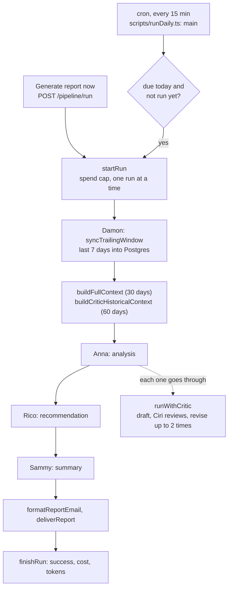
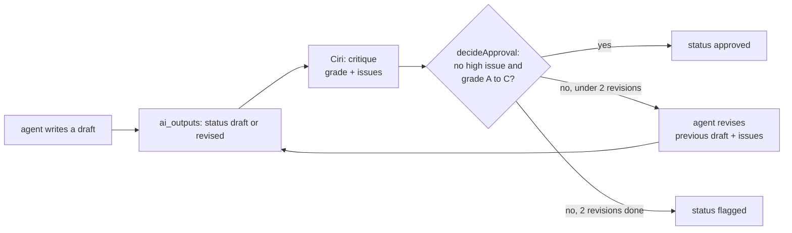
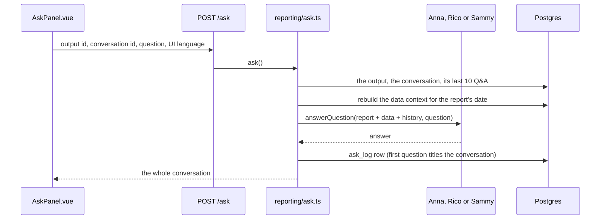
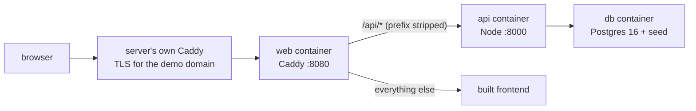

# Pitstop: a guide to the code

A plain-English map of how Pitstop works. It follows the main paths only:
one pipeline run, the Ask feature, and the read-only demo. Pitstop is a
frozen case study of about 33,000 lines, so it doesn't cover every file.

## What it is

Pitstop is an AI performance dashboard for Google Ads. A small team of
LLM agents reads an account's stored performance data, writes an
analysis, turns it into recommendations and summarises the result. A
fourth agent, the critic, reviews every output before anyone sees it.
It was built as a commissioned prototype for a used-car dealership's
Google Ads from August to October 2026, ran unattended on a daily
schedule, and was shelved before launch. All the ad data in it is
synthetic.

Each agent has a person's name (Anna, Rico, Sammy, Ciri and so on). The
[glossary](#glossary) says who is who.

## 1. One pipeline run

A "run" turns the stored ad data into one report: an analysis, a
recommendation and a summary, each reviewed by the critic.



**Step by step:**

1. **The schedule wakes up.** Cron runs `backend/scripts/runDaily.ts: main`
   every 15 minutes (the crontab is in `backend/deploy/crontab.txt`).
   - It first marks runs left "running" by a crash as failed
     (`backend/src/pipeline/pipelineRuns.ts: reconcileOrphanedRuns`).
   - It deletes prompt and response text older than 30 days
     (`backend/src/platform/trace.ts: pruneTracePayloads`).
   - Then `backend/src/pipeline/keywordSchedule.ts: runBothBlocks` runs two
     independent blocks: the reports (`reportsBlock`) and the keyword
     optimizer (`keywordBlock`). A failure in one doesn't stop the other.
2. **The reports block decides whether a run is due.** `reportsBlock` in
   `runDaily.ts` skips if reports are switched off, if it's before the run
   time set on the Settings page, or if today's run already succeeded. All
   times are Indonesia time (WIB, `backend/src/platform/timezone.ts`). It
   also checks the dead-man's switch
   (`backend/src/pipeline/cronAlerts.ts: checkDeadMansSwitch`). If a run is
   due, it calls `backend/src/pipeline/orchestrator.ts: runDaily`.
   - The "Generate report now" button reaches the same function through
     `POST /pipeline/run` in `backend/src/api/routes/pipeline.ts`.
3. **The run is opened.** `pipelineRuns.ts: startRun` refuses to start if
   this month's tracked AI cost has reached the cap (`checkSpendCeiling`).
   It then inserts a `pipeline_runs` row with status `running`. A database
   index allows only one running row, so two runs can't overlap.
   `pipelineRuns.ts: trackRun` wraps the rest of the run. It counts tokens
   and cost, opens the trace (`trace.ts: traceRun`), and at the end calls
   `finishRun` with `success`, `partial` or `failure`.
4. **Damon fetches the data.** `backend/src/data/damon.ts: syncTrailingWindow`
   writes the last 7 days into Postgres. In demo mode it generates them
   (`backend/src/data/demo/generator.ts: generateDay`). In live mode it
   would call the Google Ads API (`syncLiveWindow`). Re-fetching 7 days,
   not just yesterday, catches conversions Google reports late.
5. **The agents' input is built.** `orchestrator.ts: runAgentChain` calls
   `backend/src/data/context.ts: buildFullContext`. That turns 30 days of
   tables into one long text: campaigns, keywords, search terms, ads,
   impression share and so on. It ends with a block of facts computed in SQL
   (`buildFactsContext`), such as rankings and totals, because models are bad
   at arithmetic over tables. It also builds a 60-day history that only the
   critic sees (`buildCriticHistoricalContext`).
6. **Anna, Rico and Sammy run in order.** Each goes through
   `backend/src/agents/criticLoop.ts: runWithCritic`.
   - Anna (`backend/src/agents/anna.ts: analyze`) gets the 30-day context.
   - Rico (`backend/src/agents/rico.ts: recommend`) gets only Anna's final
     text.
   - Sammy (`backend/src/agents/sammy.ts: summarize`) gets Anna's and Rico's
     final texts.
7. **The critic loop** (`criticLoop.ts: runCriticLoop`). See the diagram
   below.
   - The agent writes a first draft. It's saved in `ai_outputs` with
     status `draft`. A blank first draft fails the run rather than being
     saved.
   - Ciri reviews it (`backend/src/agents/critic.ts: critique`). She returns
     a letter grade and a list of issues, each with a severity. The review is
     saved as its own `ai_outputs` row, pointing at the draft
     (`critiques_id`).
   - **Code decides, not the model** (`critic.ts: decideApproval`): approve
     only if there's no high-severity issue and the grade is A, B or C.
   - If it isn't approved, the agent revises. It gets its previous draft
     plus the exact issues (`backend/src/agents/revision.ts:
     buildRevisionInput`). The revision is saved with status `revised` and
     points at the draft it replaced (`revises_id`). Ciri reviews it again.
   - After 2 revisions (`MAX_REVISIONS`), or if Ciri can't produce a
     review, the last version is marked `flagged`. A flagged output is
     still shown, with its issues.
8. **Every model call goes through one function.** `backend/src/agents/llm.ts:
   complete` (and `completeJson` for the critic's JSON) calls the model
   through an OpenAI-compatible gateway. If the answer comes back empty, it
   retries once with the same token budget, then once more with double the
   budget when the first two ran out of room. `tracedCall`
   records each call as a trace step, with tokens, cost, and the full prompt
   and response.
9. **The report goes out.** `backend/src/reporting/reports.ts:
   formatReportEmail` builds the email, and
   `backend/src/platform/emailDelivery.ts: deliverReport` sends it to the
   address on the Settings page (or prints it if none is set). If anything
   threw, `runDaily.ts` sends a failure alert instead
   (`reporting/reports.ts: formatFailureAlert`).



**What a run leaves in the database:**

| Table | What's in it |
|---|---|
| `pipeline_runs` | One row per run: type, status, start and end, cost, tokens per model, a redacted error. |
| `ai_outputs` | Every draft, revision and critic review. `revises_id` and `critiques_id` link them into a chain. |
| `trace_events` | The Run Inspector's tree of steps: `run`, then `context`, `agent`, `llm_call`, `critic_review`, `decision`, `revision`, `email` and `error`. Each has its timing, tokens and cost. |
| `trace_payloads` | The bulky text for a step: the prompt, the response, or the built context. Deleted after 30 days; the steps stay. |

Writing a trace step never fails a run. `trace.ts` gives each write 5
seconds, and switches tracing off for the run after 3 failures in a row.

**How you see the report in the app:**

- **The report page:** `frontend/src/features/reports/useReportDetail.ts`
  calls `GET /reports/:id`. That reaches
  `backend/src/reporting/reporting.ts: getReportById`, which finds the
  summary and the analysis and recommendation from the same run, each with
  its latest critique.
- **The "why" trail:** `GET /outputs/:id/why-trail` walks the
  `revises_id` chain backwards (`backend/src/reporting/outputs.ts:
  getWhyTrail`), to show draft, critique and revision.
- **The Run Inspector:** `frontend/src/features/run-inspector/useRunInspector.ts`
  calls `GET /pipeline/runs/:id/trace`, which is
  `backend/src/reporting/runInspector.ts: getRunTrace`.

**Other run types use the same machinery.**
- **Weekly:** on Mondays, `orchestrator.ts: runWeekly` runs the same agent
  chain over 7 days, without a new sync.
- **Weekly feedback:** after the weekly run,
  `backend/src/pipeline/weeklyFeedback.ts: runWeeklyFeedback` reads the
  week's critiques and drafts prompt changes. They're emailed and shown on
  the Learning page, never applied.
- **Keyword optimizer:** `backend/src/pipeline/keywordOptimizer.ts:
  runKeywordOptimizer` runs a deterministic ranking engine
  (`backend/src/optimizer/engine.ts: runEngine`) and stores its
  suggestions. Then Kai ranks and explains them, and Ciri reviews Kai
  through the same critic loop.

## 2. The Ask feature

On a report, you can ask Anna, Rico or Sammy a follow-up question about
their part of it.



1. **You type a question.** The Ask drawer
   (`frontend/src/shared/report/AskPanel.vue`) calls `submit` in
   `frontend/src/shared/report/useAskPanel.ts`. Questions belong to a
   conversation; the panel opens the latest one or starts a new one.
2. **The API receives it.** `api.ask` posts to `/ask`, handled in
   `backend/src/api/routes/outputs.ts`.
3. **The question gets its context.** `backend/src/reporting/ask.ts: ask`
   loads the report output and picks the agent that wrote it, from its
   `agent_type`. It checks the conversation belongs to that output. Then it
   rebuilds the same data context the pipeline used
   (`context.ts: buildFullContext`) for the report's date, and adds the
   conversation's last 10 questions and answers (`buildConversationTranscript`).
4. **The agent answers.** For example, `anna.ts: answerQuestion` calls
   `llm.ts: complete`. Answers come back in the language the UI is showing.
5. **It's saved and shown.** `logAsk` writes an `ask_log` row. The panel
   shows the whole conversation, and can read the answer aloud.

Things to know:
- **No critic review.** Answers go straight back; Ciri only reviews pipeline
  outputs.
- **Not in the Run Inspector.** Ask isn't part of a run, so `trace.ts`
  records nothing for it.
- **The demo can't ask.** The demo login is read-only, so `POST /ask` gets
  a 403, and the Ask history is removed from the demo data.
- **Aska is different.** The "Ask Aska" page is a general assistant, not
  tied to one report (`backend/src/reporting/assistant.ts: askAssistant`).

## 3. The read-only demo

The public demo runs the real API and frontend over a cleaned copy of
the database, as three containers. It has no model keys and no schedule,
so it can't spend money.



1. **The seed is built on the laptop.** `deploy/demo/build-seed.sh`
   restores a private backup into a throwaway container and runs
   `deploy/demo/clean.sql`. That removes the owner's email, phone numbers,
   the Ask history and raw provider errors, and switches the schedules off.
   It writes `deploy/demo/seed/pitstop-demo.dump`, which is never committed.
2. **Compose starts three containers.** `deploy/demo/compose.yaml` defines
   `db`, `api` and `web`, each with memory and CPU limits, on a private
   network. Only `web` is published, on loopback by default.
3. **db:** Postgres 16. `deploy/demo/restore-seed.sh` loads the seed the
   first time the volume is created.
4. **api:** `deploy/demo/api.Dockerfile` builds the backend and runs
   `backend/dist/src/api/main.js`, with `DATA_SOURCE=demo` and no keys.
5. **web:** `deploy/demo/web.Dockerfile` builds the frontend to call `/api`
   on the same origin. `deploy/demo/Caddyfile` serves those files and
   passes `/api/*` to the API.
6. **Inside the API,** `backend/src/api/main.ts` sets things up in this
   order:
   - `GET /health`: 200 only when the database answers within 3 seconds,
     otherwise 503 (`backend/src/api/health.ts: checkHealth`);
   - `GET /config` (shows the Demo Mode badge);
   - the login route;
   - `authMiddleware`: every later route needs a token;
   - `demoReadOnly` (`backend/src/api/authMiddleware.ts`): a demo token
     gets 403 on anything but a read, and on a few private reads such as
     stored prompts;
   - the routes in `backend/src/api/routes/`.
7. **It's checked.** `deploy/demo/verify.py` calls every route as the demo
   user, checks that every write is refused, that no model was called, that
   the containers hold no keys, and that the data loaded. CI builds both
   images and validates the Caddyfile.

## Glossary

### The agents

| Name | What it does | Where |
|---|---|---|
| Orca | The orchestrator: runs the agents in order. Plain code, not a model. | `backend/src/pipeline/orchestrator.ts` |
| Damon | The data step: generates or fetches ad data and stores it. Not a model. | `backend/src/data/damon.ts` |
| Anna | Analysis: finds trends, anomalies and standout segments. | `backend/src/agents/anna.ts` |
| Rico | Recommendations: turns Anna's findings into suggestions. | `backend/src/agents/rico.ts` |
| Sammy | Summary: a short digest of Anna and Rico. | `backend/src/agents/sammy.ts` |
| Ciri | The critic: grades every output and lists its issues. | `backend/src/agents/critic.ts` |
| Kai | The keyword optimizer's agent: ranks and explains suggestions, and polishes ad copy. | `backend/src/agents/kai.ts` |
| Aska | The general voice and chat assistant on the "Ask Aska" page. | `backend/src/agents/assistant.ts` |
| Emil | The email sender. Not a model. | `backend/src/platform/emailDelivery.ts` |

Each agent's spec is in `docs/planning/original-build/agents/`.

### Pipeline terms

- **Pipeline / run:** one pass from data to report. Run types are `daily`,
  `weekly`, `weekly_feedback`, `backup` and `keyword_optimizer`
  (`pipelineRuns.ts: VALID_RUN_TYPES`).
- **Agent:** one model with its own prompt and job (see the table above).
- **Critic loop:** draft, review, revise, at most twice
  (`criticLoop.ts: runWithCritic`).
- **Draft, revised, approved, flagged:** the `status` of an `ai_outputs`
  row. A first version is `draft`, a rewrite is `revised`, and the final
  version ends `approved` or `flagged`.
- **Grade:** Ciri's letter, A to F, against the rubric in `critic.ts`.
- **Issue and severity:** one quoted problem in an output, rated `high`,
  `medium` or `low`. Only `high` blocks approval.
- **Approval rule:** `critic.ts: decideApproval`. No high issue, and a
  grade of A, B or C.
- **Why trail:** the chain of drafts, critiques and revisions behind one
  output (`reporting/outputs.ts: getWhyTrail`).
- **Run Inspector:** the page showing a run's trace
  (`frontend/src/features/run-inspector/`, backed by
  `reporting/runInspector.ts`).
- **Trace, trace event, span:** the record of a run as a tree of steps in
  `trace_events`. A span is a step with a duration; an event (a decision,
  an error) has none. Written by `platform/trace.ts: span` and `event`.
- **Payload:** the large text attached to a trace step, in
  `trace_payloads`.
- **Live console:** the real-time log panel in the UI. Fed by
  `platform/eventBus.ts: emitEvent`, streamed at `GET /console/stream`.
- **Context:** the text built from the database that an agent reads
  (`data/context.ts`). The **facts block** is its SQL-computed part, and
  the **historical context** is the critic's longer 60-day window.
- **Spend ceiling (spend cap):** the monthly AI-cost limit from the
  Settings page. A run refuses to start once it's reached
  (`pipelineRuns.ts: checkSpendCeiling`).
- **Dead-man's switch:** an alert when no run has succeeded for 30 hours,
  which catches the schedule itself going quiet
  (`cronAlerts.ts: checkDeadMansSwitch`).
- **Orphaned run:** a run left `running` by a crash. Marked failed on the
  next start (`pipelineRuns.ts: reconcileOrphanedRuns`).
- **Partial:** a run that finished but with a step degraded. For example,
  the optimizer stored its suggestions but Kai was unreachable.
- **Redaction:** removing keys and secrets from text before it's stored
  (`platform/redact.ts: redactSecrets`).
- **Period and report date:** `daily` or `weekly`, and the data's "as of"
  date. The report date can differ from when the row was created, because
  the Time Machine can move demo time forward.
- **WIB:** Western Indonesia Time (UTC+7). All schedule times and "today"
  use it (`platform/timezone.ts`).
- **Weekly feedback:** a weekly job that looks for repeated critic issues
  and drafts prompt changes for a human to read
  (`pipeline/weeklyFeedback.ts`). Shown on the Learning page.
- **Keyword optimizer:** turns keyword and search-term data into ranked
  suggestions (`pipeline/keywordOptimizer.ts`, `backend/src/optimizer/`).
  The **engine** is the deterministic part (`optimizer/engine.ts`).
- **Suggestion:** one optimizer proposal, such as a negative keyword or a
  match-type change, stored in `keyword_suggestions`.

### App terms

- **Demo mode (`DATA_SOURCE=demo`):** the ad data comes from the generator,
  not Google Ads (`platform/config.ts`).
- **Demo generator and Markov state:** `data/demo/generator.ts` makes a
  day of data. Each day is in one state (good, bad, standstill or
  volatile) that follows from the day before (`data/demo/markov.ts`), so
  trends look realistic.
- **Time Machine:** a page that pins a demo state on a future date
  (`data/demo/timeMachine.ts`).
- **Owner and demo roles:** the two logins. The demo login is read-only
  (`platform/auth.ts`, `api/authMiddleware.ts`).
- **Settings:** values set on the Settings page and stored in
  `app_settings` (`platform/settings.ts: getSettings`).
- **i18n:** "internationalisation": the UI in English or Indonesian.
  Strings are in `frontend/src/i18n/en.ts` and `id.ts`; `setLocale` in
  `i18n/index.ts` switches. Reports have their own language setting,
  `report_language`.
- **Sumopod:** the OpenAI-compatible gateway the model calls go through
  (`agents/llm.ts: getClient`). `MODEL_MINI` and `MODEL_FULL` name the two
  models used.

### Google Ads terms the code uses

- **Campaign:** a budget plus targeting, holding ad groups. The demo has 5.
- **Ad group:** a set of keywords and ads inside a Search campaign.
- **Keyword:** a phrase you bid on. Its **match type** (`exact`, `phrase`
  or `broad`, in `optimizer/types.ts`) sets how closely a search must match.
- **Search term:** what someone actually typed that triggered an ad.
- **Negative keyword:** a phrase that stops your ad showing. The optimizer
  suggests these for search terms that cost money and bring nothing.
- **Quality Score:** Google's 1 to 10 rating of a keyword, with three
  sub-scores (expected CTR, ad relevance, landing page experience).
- **Impression share:** how often your ad appeared out of the times it
  could have. "Budget lost" and "rank lost" say why it didn't.
- **Performance Max (PMax):** a Google-automated campaign type with no ad
  groups. Its next level down is the **asset group**.
- **Conversion action:** a counted result, such as a phone call or a
  WhatsApp click.
- **Optimization Score and Recommendations:** Google's own health score and
  suggestions. The agents report them as Google's, not their own.
- **Change events:** the account's edit history: budget, bidding and ad edits.
- **Ad strength:** Google's rating of an ad's copy (poor to excellent).
- **Segment:** a slice of an audience, such as a device, age range or
  region (`segments` table). Never a single person.
- **Micros:** money stored as millionths (`cost_micros`), so it stays a
  whole number.
- **CPC, CTR:** cost per click; click-through rate.
- **Developer token:** Google's permission to use the Ads API. Pitstop's
  never got past test access, so the live path was never used on a real
  account.

## Layout

```
backend/
  src/agents/      the agents, the critic loop and the model client (llm.ts)
  src/pipeline/    orchestrator, run tracking, schedules, alerts, keyword optimizer run
  src/data/        database access, Damon, the context builder, the demo generator
  src/reporting/   what the API serves: reports, outputs, Ask, Run Inspector, learning
  src/optimizer/   the keyword optimizer's deterministic engine
  src/launch/      simulated campaign launches
  src/platform/    config, auth, tracing, redaction, settings, email, cost
  src/api/         the Express app (main.ts), health check, auth, one file per route group
  scripts/         cron entry point (runDaily.ts), backup, database setup
  deploy/          how the API ran on its own server: crontab, log rotation
frontend/src/
  app/             the shell: router, nav, top bar
  features/        one folder per page (reports, run-inspector, learning, ...)
  shared/          the API client, the report drawers (Ask, why trail), utilities
  i18n/            English and Indonesian strings
db/schema.sql      every table
deploy/demo/       the read-only demo: containers, data cleaning, verify.py
evidence/          the SQL behind the case study's numbers, and run.sh
docs/              the case study, its evidence CSVs, screenshots, the manual, plans and specs
```

## Where the evidence lives

Every number in [the case study](case-study.md) comes from a CSV.

- **The queries:** `evidence/queries/*.sql`, one plain SQL file per
  question.
- **The results:** `docs/evidence/*.csv`, one per query, with the same name.
  `docs/evidence/README.md` says what each file answers and the caveats.
- **How they're made:** `evidence/run.sh` restores one frozen database
  snapshot into a throwaway container, runs every query, and writes the
  CSVs. `docs/evidence/SNAPSHOT` records the snapshot's SHA-256. The
  snapshot itself is private, because it holds full prompts and settings.
- **How CI checks them** (`.github/workflows/ci.yml`, "Evidence is complete
  and linked"): CI can't re-run the queries without the snapshot, so it
  checks the set is complete instead. Every query has a CSV, every CSV has
  a query, every CSV the case study links to exists, and `SNAPSHOT` isn't
  empty.

## Where to change things

- **An agent's prompt:** the `SYSTEM_PROMPT` in its file in
  `backend/src/agents/`. Rules shared by all agents are in `prompts.ts`.
- **The critic's rubric or approval rule:** `GRADING_RUBRIC` and
  `decideApproval` in `backend/src/agents/critic.ts`. The tests are in
  `critic.test.ts`.
- **How many revisions:** `MAX_REVISIONS` in `backend/src/agents/criticLoop.ts`.
- **Which model an agent uses:** `MODEL_MINI` and `MODEL_FULL` in
  `backend/src/agents/llm.ts`; each agent picks one.
- **What data the agents see:** `buildFullContext` in
  `backend/src/data/context.ts`.
- **The data windows (7, 30, 60 days):** the constants at the top of
  `backend/src/pipeline/orchestrator.ts`.
- **Run times, the spend cap, the report language:** the Settings page.
  Defaults and validation are in `backend/src/platform/settings.ts`.
- **What the demo account may read:** `DEMO_BLOCKED_GET` in
  `backend/src/api/authMiddleware.ts`.
- **What the demo data cleaning removes:** `deploy/demo/clean.sql`.
- **A new evidence number:** add `evidence/queries/NN-name.sql`, rerun
  `evidence/run.sh`, and commit the new CSV. CI fails if either is missing.

Older code comments cite docs by names they had before they moved, such
as `docs/PROJECT.md`. [docs/planning/README.md](planning/README.md)
lists each old name and where the file is now.
